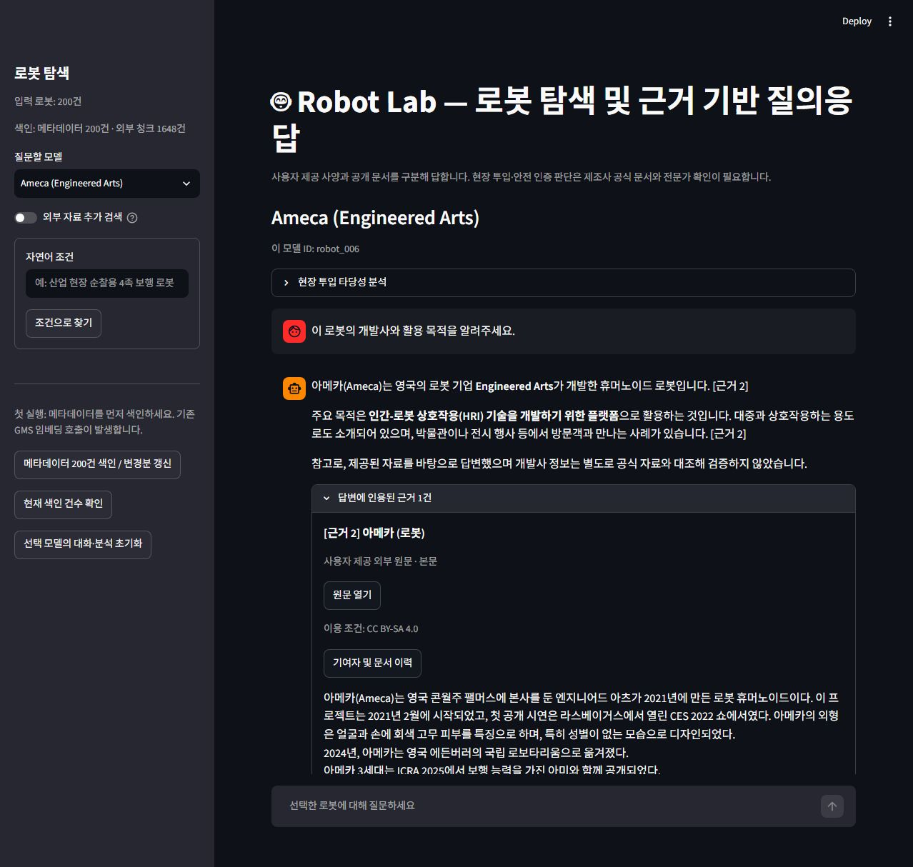
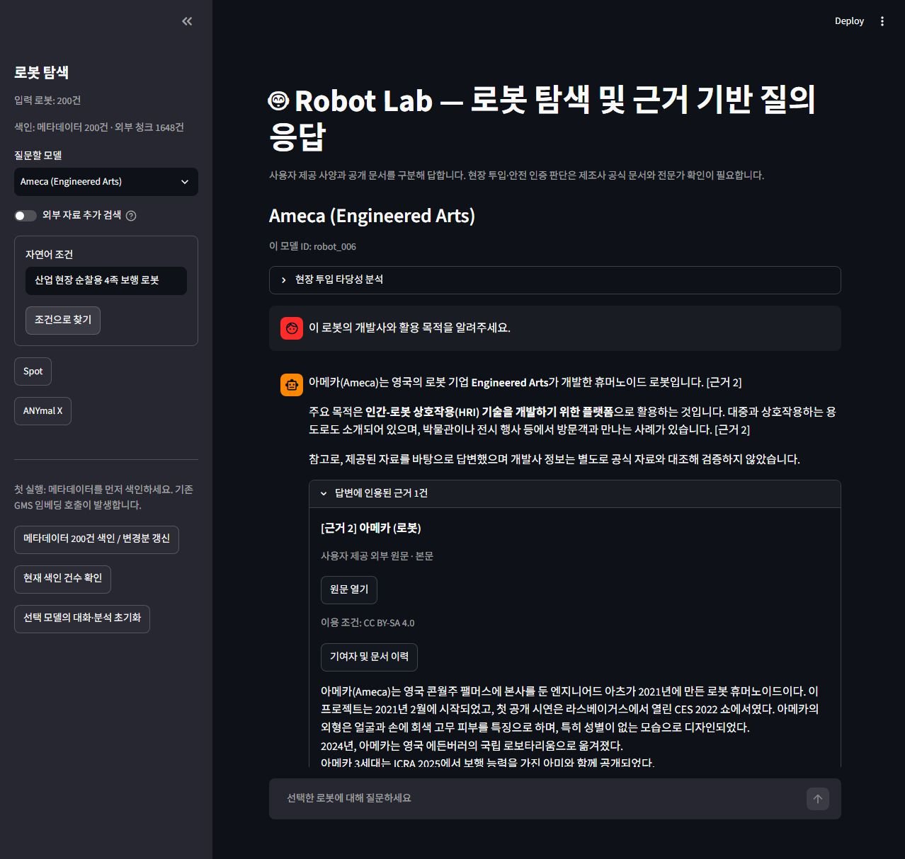
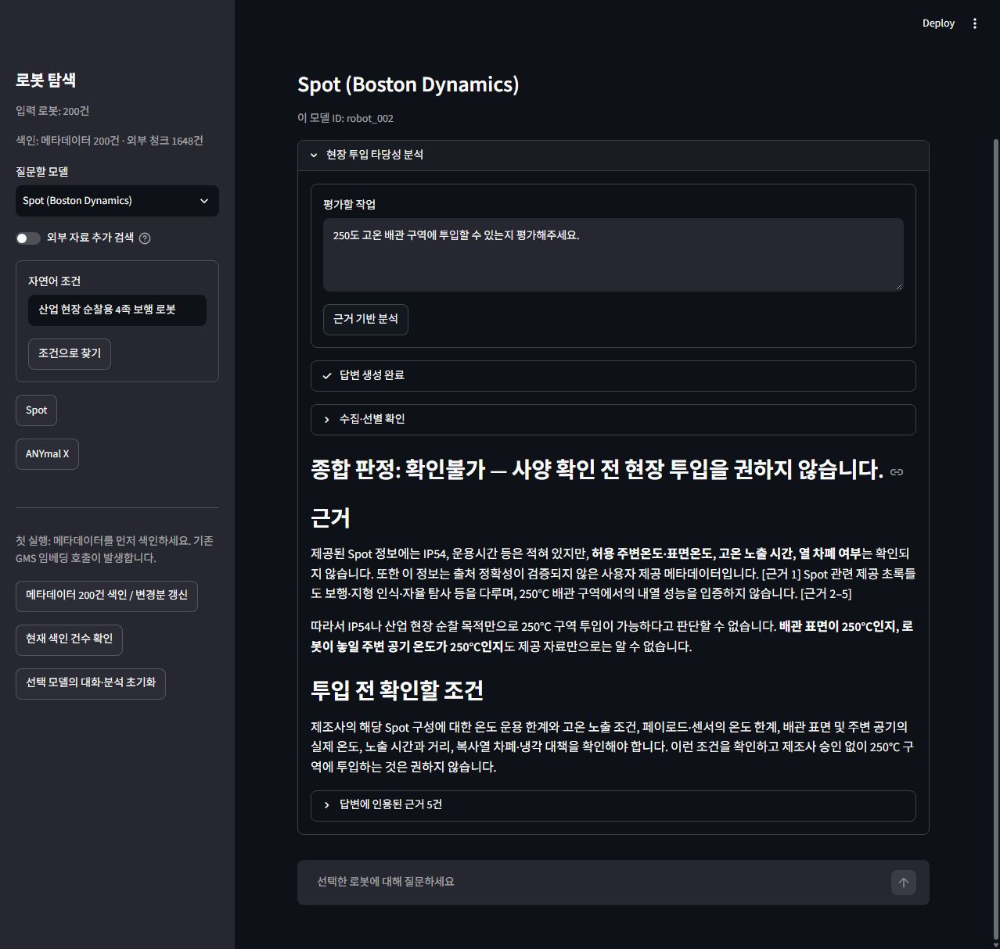

# Robot Lab 검증 체크리스트

- 검증일: 2026-10-23 (한국 시간)
- 셀프 검증: 자동 테스트 및 Codex 실행 검토, 사용자 최종 확인 전
- 상호 검증: 미실시
- 실제 결과: [verification/REPORT.md](verification/REPORT.md)
- 원자료: [실제 GMS·DB](verification/live_results.json), [자동 테스트](verification/unit_results.json), [화면](verification/browser_results.json)

## 4.1 데이터·색인

- [x] 입력 200건과 메타데이터 색인 200건 확인.
- [x] 메타데이터 두 번 실행 후 200건 유지, 변경분 0건.
- [x] 8개 필드를 포함하는 항목 텍스트 구성 확인.

판정: 확인한 범위 통과.

## 4.2 문서 수집·색인

- [x] 대표 질문의 검색어를 실제 GMS로 추출.
- [x] Spot·Ameca·Pepper의 원문을 등록하고 자체 문서 보호 및 반복 색인 확인.
- [x] 성공 수집 캐시 재사용·실패 응답 미캐시는 회귀 테스트로 확인.
- [x] 동일 질문의 검색어 캐시 재사용 로그 확인.
- [x] 동일 원문의 1000/200 및 500/100 분할 결과 비교.
- [ ] 모든 200종의 자체 문서 확보·정확한 모델 대응 확인.
- [ ] 운영 DB의 청킹 설정 변경·재색인 결과 비교.

판정: 대표 모델 통과, 전체 모델·전체 외부 출처는 미확인 또는 실패.

## 4.3 답변·근거

- [x] 실제 검색에서 Top-k 2/5와 similarity/MMR 비교.
- [x] 실제 LangGraph 처리 노드 retrieve/generate 확인.
- [x] 실제 답변 4건의 인용 번호 검사. 범위형 인용 버그 수정 후 저장 답변 재검사.
- [x] Ameca 화면에서 실제 인용만 표시하고 본문·원문·라이선스·기여자 이력 확인.
- [x] 없는 안전 인증번호에 확인불가 응답 확인.
- [x] 인용 없는 답변의 근거 추출 결과가 빈 목록인 것을 테스트. UI의 안내 분기 코드 확인.

판정: 대표 질문 통과. 모든 질문의 사실 정확성을 보장한 것은 아님.

## 4.4 서비스·화면

- [x] AppTest에서 모델 왕복 전환 후 대화 분리·유지 확인.
- [x] 실제 자연어 조건 검색에서 Spot·ANYmal X 반환.
- [x] 검색 결과 버튼으로 Spot 모델 화면 이동 확인.
- [x] 실제 GMS 현장 분석에서 확인불가·근거·미확인 조건 확인.
- [x] 브라우저에서 처리 진행 상태와 외부 API 실패 안내 확인.
- [x] 키·색인 누락은 격리된 AppTest로 검사, 화면 예외 없음.
- [x] 상단 제조사 공식 문서·전문가 확인 안내 확인.

## 4.5~4.6 심화

- [ ] F2013 별도 HTML·CSS·JS 프론트엔드: 선택 안 함.
- [x] F2014 실제 similarity/MMR 검색 결과 비교.
- [ ] F2015 RAG 전후 답변 5쌍 품질 비교: 미구현, 선택 안 함.
- [x] F2016 기존 DB에 Wikipedia·논문 초록·RSS가 함께 저장되고 출처 유형 구분.

판정: F2014·F2016은 확인한 범위 통과.

## 4.7 비기능

- [x] 등록 원문 기반 대표 질문 4건 처리 시간 11.31~17.35초 기록.
- [ ] 첫 실행·캐시 실행의 전체 응답 시간 쌍 비교.
- [x] 환경변수 키 로딩과 .env 제외 규칙 확인. 실제 키를 문서·캡처에 기재하지 않음.
- [x] 화면에 전체 프롬프트·오류 추적 정보가 출력되지 않는 오류 처리 확인.
- [x] UI·코어·수집·CLI 모듈 분리 확인.
- [x] Retry-After를 줄이지 않는 동작과 60초 초과 시 중단 테스트 통과.
- [ ] 운영자 실제 User-Agent 연락처 입력.
- [x] 대표 원문 출처·라이선스·이력 기록: [DATA_SOURCES.md](DATA_SOURCES.md).
- [ ] 메타데이터 최초 출처 및 기존 자료 전체의 개별 이용 조건 확인.

## 4.8 제출 전

- [x] 요구사항 대조표: [PROJECT_REQUIREMENTS.md](PROJECT_REQUIREMENTS.md).
- [x] RAG 설계: [RAG_DESIGN.md](RAG_DESIGN.md).
- [x] 재현 가능한 테스트 코드·실제 실행 결과·화면 캡처 정리.
- [ ] 사용자 최종 셀프 검증 및 다른 교육생 상호 검증.
- [ ] 위 미확인 항목 해소 후 최종 제출 판정.

자동 검사·대표 모델 검증 완료와 요구사항 전체 충족 판정은 구분한다. 작성자 연락처·최초 데이터 출처·상호 검증 결과는 임의로 작성하지 않았다.
