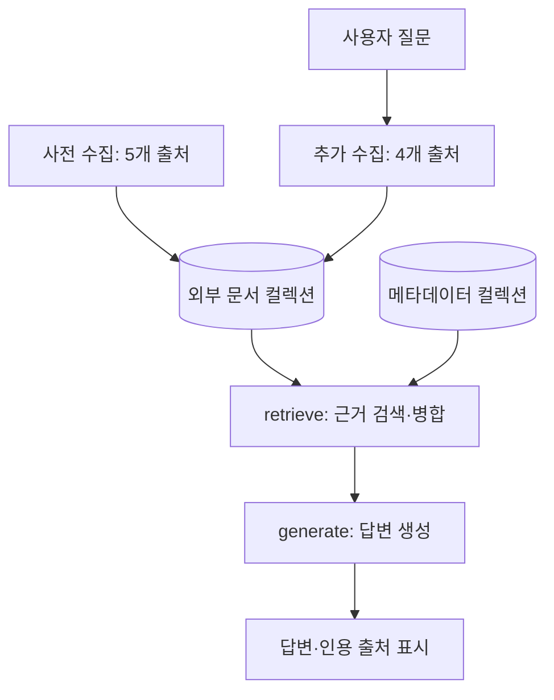

# 🤖 Robot Lab

**로봇 200종의 메타데이터와 외부 기술 문서를 활용하는 RAG 지식 서비스**

원하는 조건에 맞는 로봇을 찾고, 선택한 모델에 대해 질문할 수 있는 서비스입니다. 답변에 사용한 자료의 제목과 출처를 함께 보여주고, 확보한 근거가 부족하면 확인되지 않는다고 안내합니다.

`Python` · `Streamlit` · `LangGraph` · `LangChain` · `ChromaDB` · `GMS`

> 현재 개발·검증 중인 교육 프로젝트입니다. 기능 구현과 실제 실행 검증을 구분해 기록했습니다. 제공된 사양이나 분석 결과를 제조사의 공식 사양·안전 인증으로 대신하지 않습니다.

## 프로젝트 소개

로봇은 모델과 세대에 따라 구성과 성능이 달라집니다. 이름이 비슷한 로봇의 자료를 섞거나, 문서에 없는 내용을 추측하면 잘못된 답변을 만들 수 있습니다.

Robot Lab은 로봇의 기본 정보를 먼저 색인하고, 외부 문서를 수집·선별해 근거를 보충하는 방식으로 구성했습니다. 개발 과정에서는 답변이 출력되는 것뿐 아니라 **어떤 자료를 수집했고, 무엇을 저장했으며, 답변에서 실제로 사용했는지** 확인할 수 있도록 처리 로그를 보완했습니다.

## 주요 기능

| 기능 | 설명 |
|---|---|
| 로봇 탐색 | 200종의 목록에서 모델을 선택하거나 자연어 조건으로 후보 검색 |
| 근거 기반 질의응답 | 선택 모델의 기본 정보와 외부 문서를 검색해 답변 생성 |
| 현장 투입 분석 | 특정 작업에 대한 적합성·제약·미확인 조건을 근거와 함께 정리 |
| 출처 표시 | 답변에서 실제 인용한 자료의 번호·제목·URL 또는 파일명 표시 |
| 처리 과정 확인 | 검색어, 수집 건수, 후보 선별, 실제 색인 상태 확인 |
| 모델별 대화 | 모델을 전환해도 브라우저 세션 안에서 대화와 분석 결과를 분리해 유지 |
| 제공 원문 등록 | 네트워크 수집이 어려우면 실제 원문 TXT·MD 파일을 연결해 사용 |

## 데이터 수집과 RAG 구조

### 두 단계의 외부 자료 수집

사전 색인과 질문 시 추가 검색에 사용하는 출처를 나눴습니다.

| 단계 | 수집 출처 | 목적 |
|---|---|---|
| 사전 수집·색인 | Wikipedia, arXiv, Crossref, Semantic Scholar, IEEE Spectrum RSS | 모델별 기본 자료 준비 |
| 질문 시 추가 수집·색인 | Reddit, Google Patents, ROS Index, Wikidata | 질문에 필요한 추가 자료 탐색 |
| 답변 근거 검색 | 두 단계에서 저장한 자료와 모델 메타데이터 | 선택 모델과 질문에 맞는 근거 구성 |

**출처를 활성화했다고 정상 수집이 보장되는 것은 아닙니다.** 접근 제한, 응답 규격, 검색 결과 부족에 따라 자료를 확보하지 못할 수 있습니다. GitHub 수집은 비활성 상태입니다.

Wikipedia는 후보를 선별한 뒤 본문을 요청합니다. 논문 API와 RSS 등에서 초록·요약만 확보한 경우에는 문서 종류를 구분하여 표시합니다.

### 처리 흐름



위 도식은 전체 데이터 흐름입니다. 실제 LangGraph는 **retrieve / generate 두 노드**이며, 검색어 추출·수집·선별·색인은 retrieve 내부에서 수행합니다. 사전 색인은 별도 CLI로 실행합니다.

### 컬렉션과 식별자

| 항목 | 구현 |
|---|---|
| 기본 정보 | `robot_meta_v2`에 로봇당 텍스트 1건 저장 |
| 외부 문서 | `robot_docs_v2`에 청크와 제목·출처·로봇 ID 저장 |
| 모델 구분 | 화면 표시 이름 대신 `robot_id` 사용 |
| 검색 범위 | 선택한 `robot_id`로 외부 문서 검색 범위 제한 |
| 중복 방지 | 문서·청크 내용으로 만든 해시 ID를 비교해 같은 청크 재저장 방지 |
| 캐시 | 검색어와 수집 문서를 재사용하고, DB가 없으면 캐시에서 복구 |

원문 캐시와 DB는 로컬 파일로 저장합니다. 로봇별 작업 완료 여부를 기록해 전체 단계를 건너뛰는 방식은 아니므로, 재실행하면 후보 선별 LLM 호출이 다시 발생할 수 있습니다.

## 개발 중 해결한 문제

| 문제 | 변경 내용 |
|---|---|
| `Atlas (Electric)`이 `Atlas`로 잘림 | 원본 모델 정보를 유지하고 ID로 자료 연결 |
| API 실패 시 임의 설명을 문서로 저장 | 실제 내용이 없는 응답을 제외하고 실패 상태 표시 |
| 문서를 저장한 뒤 관련성을 선별 | 후보 선별 후 본문 확보·색인하도록 순서 변경 |
| 캐시가 있으면 DB 복구를 건너뜀 | 원문 캐시와 색인 상태를 분리 |
| 실행 파일마다 청크 ID 규칙이 다름 | 공통 코어에서 색인 규칙 통일 |
| 긴 검색어 전체 일치로 검색 범위가 좁음 | 짧은 모델명·한국어 검색어를 포함하고 출처별 검색 방식 조정 |
| 후보 채택과 실제 저장을 구분하기 어려움 | 선별 여부와 본문/요약 색인 상태를 따로 표시 |
| 모델 호출 시 HTTP 400 발생 | 지원하지 않는 `temperature=0` 인자 제거 |
| Windows에서 requirements 읽기 오류 발생 | UTF-8 실행 명령 사용 및 한글 주석 제거 |
| 사전 수집과 질문용 출처가 혼합됨 | `ingest_sources`와 `question_sources` 분리 |

자료를 많이 수집하는 것과 좋은 근거를 확보하는 것은 달랐습니다. 일반 기술 문서를 배경 설명에 활용하더라도, 해당 내용을 선택 모델의 실제 부품이나 성능으로 단정하지 않도록 선별·답변 프롬프트를 보완했습니다.

## 기술 구성

| 구분 | 사용 기술 |
|---|---|
| 언어 | Python |
| 화면 | Streamlit |
| RAG 구성 | LangChain, LangGraph |
| 벡터 저장소 | 로컬 ChromaDB |
| 생성·임베딩 | GMS 프록시를 통한 모델 호출 |
| 입력 데이터 | 로봇 메타데이터 JSON 200건 |
| 문서 수집 | Requests, XML 파싱, 공개 API·RSS |
| 검증 | Python unittest 기반 모의 회귀 테스트 |

코드 개선에는 생성형 AI를 활용했으며, 요구사항 대조와 실제 실행 로그를 통해 수정 결과를 점검했습니다.

## 프로젝트 구조

| 파일·폴더 | 역할 |
|---|---|
| `app.py` | 로봇 선택, 채팅, 조건 탐색, 현장 분석, 근거 표시 |
| `rag_core.py` | 데이터 검증, 캐시, 색인, 검색, 프롬프트, LangGraph |
| `sources.py` | 출처별 요청·응답 해석·수집 함수 |
| `ingest_meta.py` | 메타데이터와 기본 외부 자료의 사전 색인 CLI |
| `settings.json` | 모델·청킹·검색·단계별 출처 설정 |
| `robots_data.json` | 로봇 메타데이터 200건 |
| `local_documents.json` | 사용자가 확보한 실제 원문 파일 등록 |
| `documents/` | 등록할 TXT·MD 원문 파일 |
| `tests/` | 외부 호출 없는 모의 회귀 테스트 |
| `DATA_SOURCES.md` | 자료 출처와 이용 조건 확인 현황 |
| `VALIDATION.md` | 검증 범위와 남은 확인 항목 |

## 실행 방법

아래 명령은 **Windows Git Bash** 기준입니다. 실제 실행이 확인된 Python은 3.11이며, `py`와 `python`이 서로 다른 Python을 가리킬 수 있습니다. 설치와 실행에는 같은 환경을 사용하세요.

### 1. 패키지 설치

프로젝트 폴더에서 실행합니다.

```bash
python -m venv .venv
source .venv/Scripts/activate
python -X utf8 -m pip install -r requirements.txt
```

`requirements.txt`는 과제 명세서에 기재된 버전을 바탕으로 작성했습니다. 전체 설치 조합은 제공 환경에서 검증하지 못했으며, 설치 오류가 발생하면 해당 오류를 기준으로 의존성을 확인해야 합니다.

### 2. GMS 키 설정

`.env.example`을 `.env`로 복사하고 기존에 발급받은 GMS 키를 입력합니다.

```env
GMS_KEY=YOUR_GMS_KEY
```

실제 키는 저장소에 올리지 않습니다. 이 프로젝트는 ChatGPT 구독을 자동으로 연결해 사용하는 구조가 아닙니다.

### 3. 출처 설정 확인

```bash
python ingest_meta.py --list-sources
```

사전 색인용 출처 5개와 질문 시 추가 검색용 출처 4개가 표시됩니다. 이 명령은 실제 API 수집 성공을 검사하지 않습니다.

### 4. 메타데이터 색인

```bash
python ingest_meta.py
```

옵션 없이 실행하면 메타데이터만 색인합니다. 로봇 200종의 외부 자료까지 자동으로 수집하지 않습니다.

### 5. 기본 외부 자료 사전 수집

먼저 특정 모델로 확인할 수 있습니다.

```bash
python ingest_meta.py --external --robot robot_001
```

전체 모델을 처리하려면:

```bash
python ingest_meta.py --external --all
```

사전 수집용 5개 출처만 사용합니다. 검색어 추출·후보 선별·임베딩에 기존 GMS 사용량이 발생하므로, 전체 실행 전에 할당량을 확인하세요.

### 6. 앱 실행

```bash
python -m streamlit run app.py
```

질문하면 추가 검색용 4개 출처에서 자료를 탐색하고, 저장된 사전 자료와 함께 검색합니다. `.env`, `chroma_db_v2`, `cache_v3`가 유지되어 있으면 기존 자료를 재사용할 수 있습니다.

## 설정 예시

다음은 `settings.json`의 주요 설정 일부입니다.

```json
{
  "llm_model": "gpt-6.1-sol",
  "embedding_model": "text-embedding-3-small",
  "chunk_size": 1000,
  "chunk_overlap": 200,
  "top_k": 5,
  "ingest_sources": [
    "wikipedia", "arxiv", "crossref", "semantic_scholar", "ieee"
  ],
  "question_sources": [
    "reddit", "patents", "ros", "wikidata"
  ]
}
```

전체 설정 파일에는 위 항목 외에도 HTTP 요청과 검색 관련 설정이 있습니다. 위 예시만으로 기존 파일 전체를 덮어쓰지 마세요.

LLM은 GMS에서 지원하는 정확한 모델명으로 변경할 수 있습니다. LLM만 바꿀 때 기존 DB를 삭제할 필요는 없습니다. 임베딩 모델을 변경하면 저장 경로가 분리되므로, 해당 모델로 메타데이터·문서를 다시 준비해야 합니다.

## 검증 현황

| 검증 항목 | 확인 결과 |
|---|---|
| 입력 데이터 검사 | 200건의 필수 필드·고유 ID 확인 |
| 실제 메타데이터 색인 | 사용자 환경에서 200건 확인 |
| 실제 외부 자료 처리 | HCR-10 사례에서 후보 25건 중 2건 채택 및 초록/요약 색인 확인 |
| 모의 회귀 테스트 | 과거 56개 통과 표기는 근거 파일 부재로 미확인. 현재 재현 가능한 테스트는 tests/test_requirements.py와 verification/REPORT.md 참조 |
| 출처별 역할 분리 | 사전 5개·질문 4개만 호출하는 모의 검증 완료 |
| 공통 DB 검색 | 사전 자료와 질문 시 추가 자료를 함께 검색하는 모의 검증 완료 |
| 외부 본문 수집부터 답변 인용까지 | 최종 실행 증빙 추가 필요 |
| 응답 시간·검색 품질 비교 | 추가 측정 필요 |

테스트 실행:

```bash
python -m unittest discover -s tests -v
```

**모의 테스트는 실제 GMS·공개 API·Streamlit·Chroma 전체 연동의 성공을 뜻하지 않습니다.** 후보 수, 채택 수, 저장 청크 수, 실제 인용 수를 구분해 확인합니다.

## 현재 한계와 개선 과제

- 외부 자료가 없는 모델은 사용자 제공 메타데이터만으로 답변할 수 있습니다.
- 일부 출처는 초록·RSS 요약만 수집하며 전문을 확보한 것으로 취급하지 않습니다.
- Google Patents와 ROS Index의 기존 엔드포인트는 정상 수집 여부를 별도로 확인해야 합니다.
- Semantic Scholar 등은 호출 제한으로 일부 요청이 실패할 수 있습니다.
- 모델 자체 문서와 일반 기술 문서의 구분은 실제 자료를 통해 계속 검증해야 합니다.
- 메타데이터의 공식 원문·모델 버전과 자료별 이용 조건 기록이 부족합니다.
- 완료한 로봇을 통째로 건너뛰는 기능은 없으며, 캐시가 있어도 후보 선별 호출은 다시 발생할 수 있습니다.

`organization_spend_limit_exceeded`가 발생하면 반복 실행을 중단하고 GMS 운영 담당자에게 한도를 확인해야 합니다. 단순한 요청 속도 제한과 구분하며, 개인 결제나 한도 상향을 자동으로 진행하지 않습니다.

## 저장소에 올리지 않는 파일

`.gitignore`에 다음 항목을 반영합니다.

```gitignore
.env
.env.*
!.env.example
venv/
.venv/
__pycache__/
*.pyc
chroma_db/
chroma_db_v2/
cache_v3/
```

메타데이터·수집 원문은 출처와 재배포 가능 여부를 확인한 뒤 공개합니다. 문서에 API 키나 개인 정보가 포함되어 있지 않은지도 확인하세요.

---

이 저장소는 구현 과정과 검증 결과를 함께 정리하는 교육·포트폴리오 프로젝트입니다. 정확한 사양과 현장 투입 가능 여부는 제조사 공식 자료와 별도 검증을 통해 확인해야 합니다.
